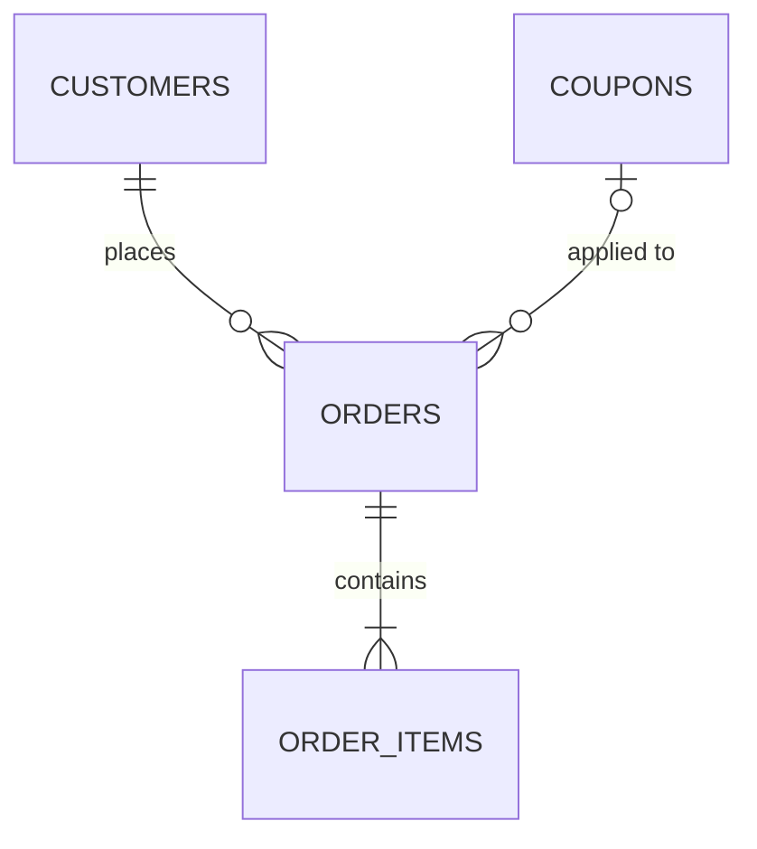

# Example output

**User request:** "Implement: customers can apply a discount coupon to their order before checkout."
**Codebase:** Spring Boot 3, Java 17, JPA, JUnit 5 + Mockito + MockMvc.

---

# Feature Plan: Apply Coupon to Order  (PLAN MODE — no changes made)

## 1. Requirement (User Stories & Acceptance Criteria)

**US1** — As a **customer**, I want to **apply a coupon code to my pending order**, so that **I pay a discounted price**.
**US2** — As a **customer**, I want to **remove an applied coupon**, so that **I can try a different one**.

**Acceptance Criteria**
- **AC1** — Given a pending order and a valid active coupon, When I apply the code, Then the discount is calculated and the new total is returned.
- **AC2** — Given an expired coupon, When I apply it, Then I get 422 `COUPON_EXPIRED` and the total is unchanged.
- **AC3** — Given an order total below the coupon's minimum, When I apply it, Then I get 422 `MIN_ORDER_NOT_MET`.
- **AC4** — Given an order that already has a coupon, When I apply another, Then the new one replaces the old (one coupon per order).
- **AC5** — Given an order that is not PENDING (paid/cancelled), When I apply a coupon, Then I get 409 `ORDER_NOT_EDITABLE`.
- **AC6** — Given an order owned by another customer, When I apply a coupon, Then I get 404 (don't reveal it exists).
- **Proposed AC7** — Discount never makes total negative (capped at order subtotal).

**Out of scope:** creating/managing coupons (admin), stacking multiple coupons, per-user usage limits.

## 2. Codebase Patterns

| Area | Finding | Evidence |
|---|---|---|
| Layering | Controller → Service → Repository, services are `@Transactional` | `order/OrderController.java`, `order/OrderService.java` |
| Naming | `XxxRequest` / `XxxResponse` records in `dto/` package | `order/dto/CreateOrderRequest.java` |
| API style | `/api/v1`, plural nouns, sub-resources for owned things | `OrderController.java:18` `@RequestMapping("/api/v1/orders")` |
| Validation | Jakarta `@NotBlank`, `@Size` on request records | `CreateOrderRequest.java` |
| Errors | `BusinessException(ErrorCode)` → `GlobalExceptionHandler` → `ErrorResponse{code,message,timestamp}` | `common/GlobalExceptionHandler.java` |
| Money | `BigDecimal`, scale 2, `RoundingMode.HALF_UP` | `order/Order.java:35` |
| Auth & security | JWT filter + `@AuthenticationPrincipal UserPrincipal`; rate limiting via Bucket4j `@RateLimited` (used on login); `AuditLogger.log(actor, action, target)` | `OrderController.java:30`, `security/JwtFilter.java`, `auth/AuthController.java:22`, `common/AuditLogger.java` |
| Tests | Unit: Mockito on service; API: `@WebMvcTest`; names `should_X_when_Y` | `OrderServiceTest.java` |

## 3. Schema & Relationships

### 3.1 Existing Tables
| Table | Key columns | Constraints & indexes | Evidence |
|---|---|---|---|
| `orders` | `id` uuid PK, `public_id` varchar, `customer_id` uuid NOT NULL, `status` varchar(enum), `subtotal` numeric(12,2), `currency` char(3), `version` int | FK `customer_id → customers.id`, idx `(customer_id)`, `version` = optimistic lock | `db/migration/V3__orders.sql`, `order/Order.java` |
| `order_items` | `id`, `order_id` NOT NULL, `price` numeric(12,2), `qty` int | FK `order_id → orders.id` ON DELETE CASCADE | `V3__orders.sql` |
| `coupons` | `id` uuid PK, `code` varchar(32), `type` varchar, `value` numeric(12,2), `min_order_amount` numeric(12,2) NULL, `expires_at` timestamptz, `description` varchar NULL, `active` bool | UNIQUE `(code)` | `V7__coupons.sql` (table exists, used only by admin module) |

### 3.2 Relationships
| From | To | Cardinality | FK / join | Owning side & cascade/fetch | Business meaning |
|---|---|---|---|---|---|
| customers | orders | 1 : N | `orders.customer_id` | Order owns FK, LAZY | A customer places many orders; used for the ownership check (AC6) |
| orders | order_items | 1 : N | `order_items.order_id` | Order, cascade ALL, LAZY | Subtotal is the sum of items |
| coupons | orders | 1 : N (new) | `orders.coupon_id` (new) | Order owns FK, no cascade, LAZY | One coupon can be used on many orders; an order has at most one coupon |

**Risks noticed:** loading `order.items` to recompute subtotal would be N+1 — use the stored `orders.subtotal`. There is no cascade from coupons to orders, which is correct: deleting a coupon must not delete orders, so the FK should be `ON DELETE SET NULL` or deletion should be blocked.

### 3.3 Proposed Schema Changes (not applied)
Migration `V12__add_coupon_to_orders.sql`:
| Change | Type | Nullable / default | Why |
|---|---|---|---|
| `orders.coupon_id` | uuid FK → coupons.id, ON DELETE RESTRICT | NULL | Links the applied coupon (one per order, AC4) |
| `orders.discount_amount` | numeric(12,2) | NOT NULL DEFAULT 0 | Freezes the discount at apply time, so a later coupon edit doesn't change a placed order's price |
| index `idx_orders_coupon_id` | — | — | FK lookups and future "orders using coupon X" reports |

Backward-compatible (nullable column + default), so existing rows need no backfill. Rollback: drop the index and the two columns.
