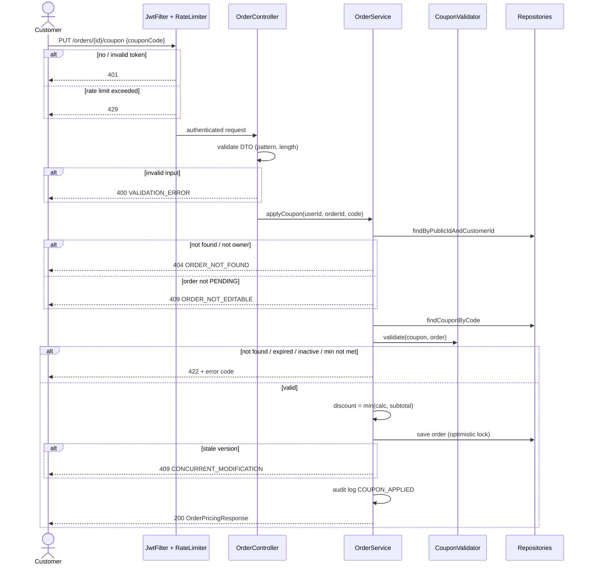

# Example plan (continued): Apply Coupon to Order

Part of the worked example; earlier sections are in the other `plan-*.md` files.

## 4. Implementation Idea

### 4.1 Approach & Files Affected
Add a `coupon` package (entity, repository, `CouponValidator`) and extend `OrderService` with `applyCoupon` / `removeCoupon`. The order keeps a reference to the applied coupon and a stored `discountAmount`, so the price the customer saw is frozen even if the coupon is edited later. Validation lives in `CouponValidator` so each rule is unit-testable on its own. Errors reuse `BusinessException` + `ErrorCode`, matching `OrderService`.

**Files that would change (not touched):** new `coupon/CouponRepository.java`, `coupon/CouponValidator.java`, `order/dto/ApplyCouponRequest.java`, `order/dto/OrderPricingResponse.java`, `V12__add_coupon_to_orders.sql`; modified `Order.java`, `OrderService.java`, `OrderController.java`, `ErrorCode.java`.

### 4.2 Endpoints

| Method | URL | Purpose | Success | Errors |
|---|---|---|---|---|
| PUT | `/api/v1/orders/{orderId}/coupon` | Apply / replace coupon | 200 `OrderPricingResponse` | 400, 404, 409, 422 |
| DELETE | `/api/v1/orders/{orderId}/coupon` | Remove coupon | 200 `OrderPricingResponse` | 404, 409 |

Why: the coupon is a **single sub-resource of the order** (one per order), so `/orders/{id}/coupon` (singular) fits better than a verb URL like `/applyCoupon`. **PUT** because applying the same code twice gives the same result (idempotent) and replaces any existing coupon (AC4). DELETE returns the recalculated pricing instead of 204 so the UI can refresh totals without a second call.

### 4.3 DTOs

**ApplyCouponRequest**
```json
{ "couponCode": "SUMMER10" }
```
| Field | Type | Required | Validation | Maps to | Meaning |
|---|---|---|---|---|---|
| couponCode | string | yes | `@NotBlank`, max 32, trimmed, uppercased | `coupons.code` (lookup) | The code the customer typed. Normalized so "summer10 " matches "SUMMER10". |

**OrderPricingResponse**
```json
{
  "orderId": "ord_8f2a",
  "subtotal": 120.00,
  "discountAmount": 12.00,
  "total": 108.00,
  "currency": "USD",
  "appliedCoupon": { "code": "SUMMER10", "type": "PERCENTAGE", "value": 10, "description": "10% off summer sale" }
}
```
| Field | Type | Required | Maps to | Meaning |
|---|---|---|---|---|
| orderId | string | yes | `orders.public_id` | Public order id, so the client confirms which order was updated. |
| subtotal | decimal(2) | yes | `orders.subtotal` | Sum of line items before discount, shown as the "original" price. |
| discountAmount | decimal(2) | yes | `orders.discount_amount` | Money taken off; `0.00` when no coupon. Stored, so it stays fixed. |
| total | decimal(2) | yes | derived | `subtotal − discountAmount`, never below 0 (AC7). What the customer will pay. |
| currency | string (ISO 4217) | yes | `orders.currency` | Makes amounts unambiguous for display. |
| appliedCoupon | object / null | no | via `orders.coupon_id` | `null` after DELETE or when no coupon. |
| appliedCoupon.code | string | yes | `coupons.code` | Normalized code, to show "SUMMER10 applied". |
| appliedCoupon.type | enum `PERCENTAGE`/`FIXED` | yes | `coupons.type` | Lets the UI render "10%" vs "$10". |
| appliedCoupon.value | decimal | yes | `coupons.value` | The coupon's face value (10 = 10% or $10 depending on type). |
| appliedCoupon.description | string | no | `coupons.description` | Human-readable label for the UI. |

Deliberately **not** exposed: coupon internal id, usage counters, `minOrderAmount` (avoid leaking campaign rules — error message says the minimum instead).

**ErrorResponse** (existing)
```json
{ "code": "COUPON_EXPIRED", "message": "Coupon SUMMER10 expired on 2026-09-30", "timestamp": "2026-11-04T10:00:00Z" }
```

## 5. Security Review

| # | Risk (OWASP API) | Where | Mitigation in this plan | Test ref |
|---|---|---|---|---|
| SEC1 | Broken authentication (API2) | both endpoints | Behind the existing `JwtFilter`; no anonymous access | S1 |
| SEC2 | BOLA / IDOR (API1) | `{orderId}` in URL | Ownership checked **in the query** (`findByPublicIdAndCustomerId`). "Not yours" and "doesn't exist" both return the same 404 | S2 |
| SEC3 | Mass assignment (API3) | request body | `ApplyCouponRequest` only has `couponCode`. Unknown fields like `discountAmount`/`total` are ignored; the discount is always computed server-side | S3 |
| SEC4 | Excessive data exposure (API3) | response | No coupon internal id, `customer_id`, `min_order_amount`, or usage counters. Errors carry no stack traces (existing handler) | S3 |
| SEC5 | Injection | `couponCode` | Allow-list pattern `^[A-Z0-9_-]{1,32}$` after normalization; JPA parameter binding only | S4 |
| SEC6 | Coupon brute force / enumeration (API4) | PUT endpoint | `@RateLimited(10/min per user)`, reusing Bucket4j → 429 | S5 |
| SEC7 | Race / double apply (business logic) | `orders` row | Optimistic lock on `orders.version` → 409 | Group 6 |
| SEC8 | Missing audit trail | apply/remove | `AuditLogger.log(userId, "COUPON_APPLIED", orderId)`; the JWT is never logged | S6 |
| — | Function-level auth (API5) | — | Not applicable: customer-only endpoints, no admin action here | — |

## 6. Workflow Diagram

A sequence diagram, chosen because the request passes security checks and several layers, with rejection points at each.


